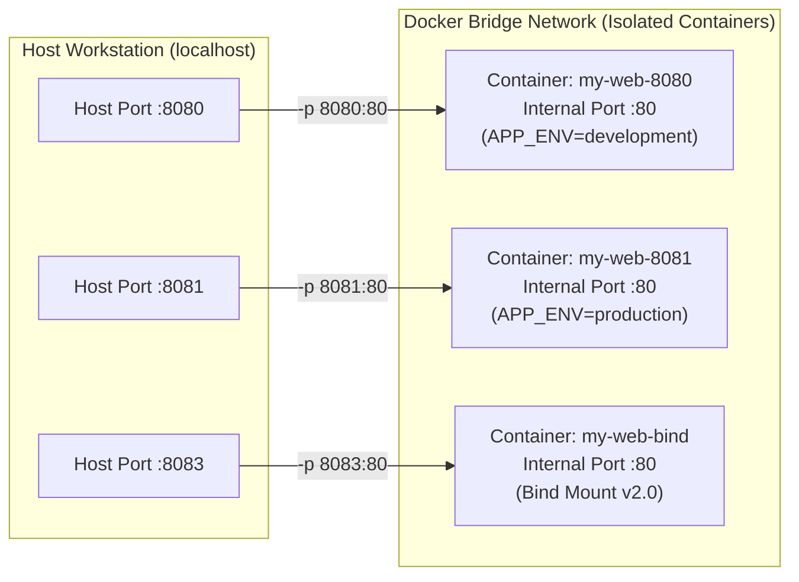
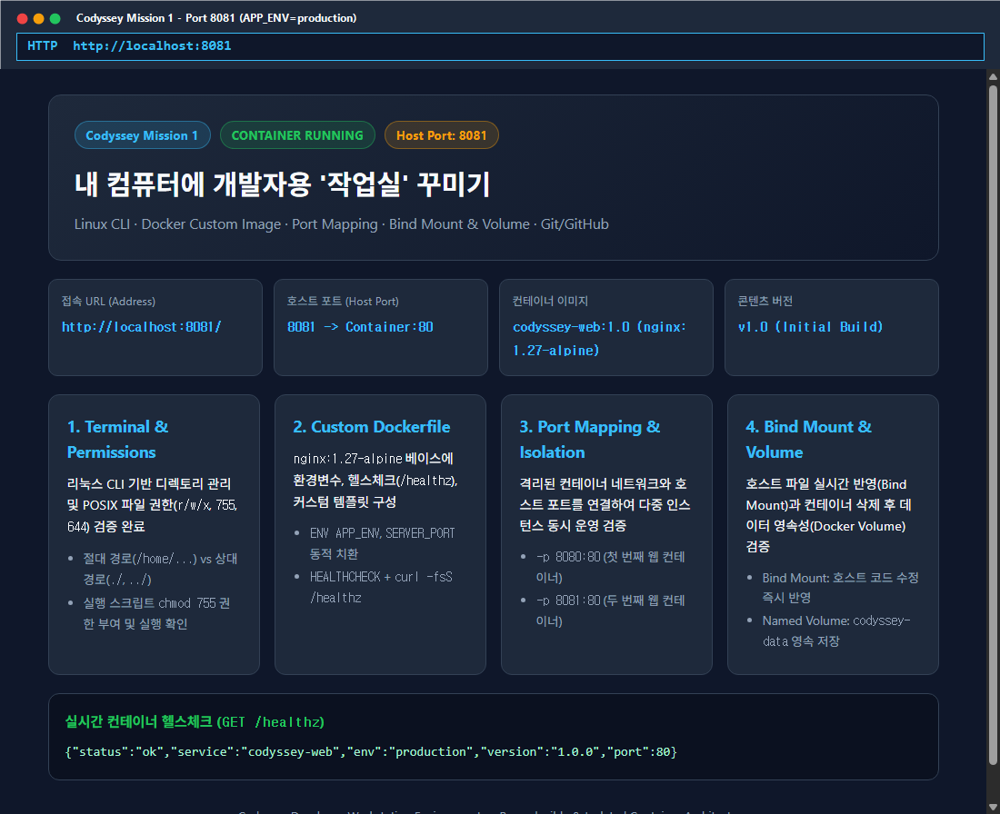
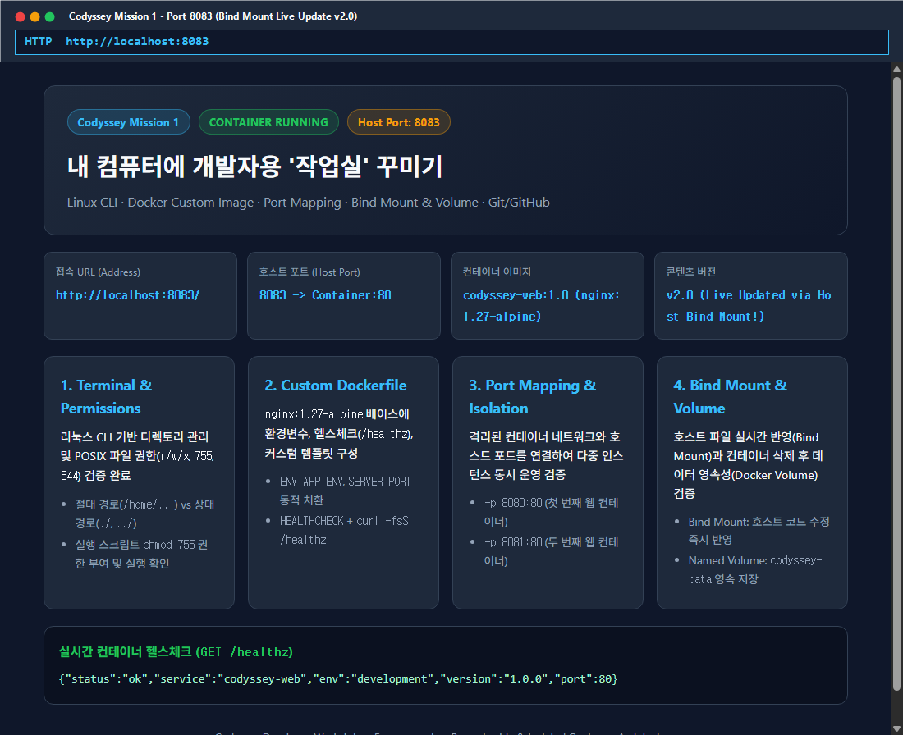
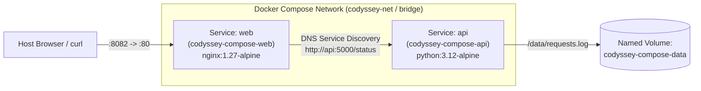

# 내 컴퓨터에 개발자용 '작업실' 꾸미기 (Codyssey Mission 1)

> **재현 가능한 개발 워크스테이션(Developer Workstation) 구축 프로젝트**  
> 리눅스 CLI(터미널 & 권한 관리), Docker 컨테이너 및 커스텀 `Dockerfile` 웹 서버, 포트 매핑·바인드 마운트·볼륨 영속성 검증, Docker Compose 멀티 컨테이너 아키텍처, 그리고 Git/GitHub 버전 관리 환경을 직접 구축하고 모든 실행 증거를 문서화한 저장소입니다.

---

## 목차 (Table of Contents)

1. [프로젝트 개요](#1-프로젝트-개요)
2. [실행 환경](#2-실행-환경)
3. [수행 항목 체크리스트](#3-수행-항목-체크리스트)
4. [검증 방법 및 산출물 위치 링크](#4-검증-방법-및-산출물-위치-링크)
5. [핵심 수행 로그 및 검증 증거](#5-핵심-수행-로그-및-검증-증거)
   - [5.1 터미널 기본 조작 로그](#51-터미널-기본-조작-로그)
   - [5.2 파일 및 디렉토리 권한(chmod) 실습](#52-파일-및-디렉토리-권한chmod-실습)
   - [5.3 Docker 설치 및 데몬 기본 점검](#53-docker-설치-및-데몬-기본-점검)
   - [5.4 Docker 기본 운영 명령 및 컨테이너 실행 실습 (hello-world, ubuntu)](#54-docker-기본-운영-명령-및-컨테이너-실습-hello-world-ubuntu)
   - [5.5 기존 Dockerfile 기반 커스텀 웹 서버 이미지 제작](#55-기존-dockerfile-기반-커스텀-웹-서버-이미지-제작)
   - [5.6 포트 매핑(-p) 다중 실행 및 브라우저 접속 증거](#56-포트-매핑-p-다중-실행-및-브라우저-접속-증거)
   - [5.7 바인드 마운트 실시간 변경 반영 및 Docker 볼륨 영속성 검증](#57-바인드-마운트-실시간-변경-반영-및-docker-볼륨-영속성-검증)
   - [5.8 Git 설정 및 GitHub / VSCode 연동 (민감정보 마스킹)](#58-git-설정-및-github--vscode-연동-민감정보-마스킹)
6. [보너스 과제 수행 결과 (Docker Compose · 환경 변수 · SSH 키)](#6-보너스-과제-수행-결과-docker-compose--환경-변수--ssh-키)
7. [트러블슈팅 (문제 → 원인 가설 → 확인 → 해결/대안)](#7-트러블슈팅-문제--원인-가설--확인--해결대안)
8. [과제 목표 핵심 개념 정리 (Self-Explanation)](#8-과제-목표-핵심-개념-정리-self-explanation)
9. [평가자용 재현 가이드 (Quick Start)](#9-평가자용-재현-가이드-quick-start)

---

## 1. 프로젝트 개요

### 미션 목표 요약
* **"내 컴퓨터에서만 돌아가는 코드"** 문제를 해결하고, 팀원 누구나 동일한 명령으로 동일한 실행 환경을 재현할 수 있는 **표준 개발 워크스테이션**을 구축합니다.
* **리눅스 CLI(터미널)** 로 디렉토리 구조와 POSIX 파일 권한(`r/w/x`, `755`, `644`, `700`)을 직접 제어합니다.
* **Docker 및 커스텀 `Dockerfile`** 을 작성하여 웹 서버(`nginx:1.27-alpine`)에 정적 웹 애플리케이션, 동적 환경 변수 템플릿(`envsubst`), 헬스체크(`/healthz`)를 결합한 불변(Immutable) 이미지를 빌드합니다.
* **포트 매핑(`-p`)**, **바인드 마운트(`-v /host:/container`)**, **네임드 볼륨(`docker volume`)** 실습을 통해 네트워크 격리·호스트 파일 실시간 연동·컨테이너 삭제 후 데이터 영속성의 구조적 원리를 검증합니다.
* **Docker Compose 멀티 컨테이너(`web` + `api`)** 와 **Git/GitHub 연동**을 통해 실제 서비스 개발 및 협업 파이프라인의 기반을 완성합니다.

### 저장소 디렉토리 구조

```text
mission1/
├── README.md                            # 전체 수행 과정, 로그, 스크린샷, 트러블슈팅, 개념 정리 기술 문서
├── Dockerfile                           # 커스텀 NGINX 웹 서버 이미지 빌드 정의서 (nginx:1.27-alpine 기반)
├── docker-compose.yml                   # [보너스] 웹 서버(web) + 보조 API 서버(api) 멀티 컨테이너 구성
├── .env.example                         # [보너스] 환경 변수 주입 예시 템플릿
├── .gitignore                           # 개인키, 인증 토큰, 로컬 비밀 설정 파일 제외 규칙
├── app/                                 # 커스텀 웹 서버 정적 소스코드
│   ├── index.html                       # 접속 포트, 환경 정보, 실시간 /healthz 상태를 표시하는 대시보드
│   └── style.css                        # 다크 테마 스타일시트
├── bind_site/                           # 바인드 마운트 실시간 수정 반영 실습용 호스트 디렉토리 (v2.0 반영본)
│   ├── index.html
│   └── style.css
├── nginx/
│   └── default.conf.template            # SERVER_PORT, APP_ENV, APP_VERSION 동적 치환 및 /healthz 설정
├── api/                                 # [보너스] 멀티 컨테이너 통신 및 볼륨 카운터 검증용 Python API 서비스
│   ├── Dockerfile
│   └── server.py
├── assets/                              # 브라우저 접속 증거 스크린샷 (주소창 및 포트 번호 포함)
│   ├── browser_port_8080.png            # http://localhost:8080 접속 화면 (APP_ENV=development)
│   ├── browser_port_8081.png            # http://localhost:8081 접속 화면 (APP_ENV=production)
│   └── browser_bind_mount_8083.png      # http://localhost:8083 바인드 마운트 실시간 수정(v2.0) 반영 화면
└── logs/                                # 터미널 및 Docker 실행 원본 로그 아카이브
    ├── 01_terminal_and_permissions.log  # 리눅스 CLI 기본 조작 및 chmod 권한 실습 전체 로그
    ├── 02_docker_operations.log         # Docker 설치 점검, hello-world, ubuntu, 커스텀 이미지 빌드/운영 로그
    ├── 03_volume_and_mount.log          # 바인드 마운트 전/후 비교 및 Docker 볼륨 영속성 검증 로그
    └── 04_bonus_compose_and_ssh.log     # 보너스 과제(Docker Compose 멀티 컨테이너, 환경 변수, SSH 키) 로그
```

---

## 2. 실행 환경

| 구분 | 상세 환경 및 버전 | 비고 |
| :--- | :--- | :--- |
| **Host OS / Linux** | Windows 11 + WSL2 **Ubuntu 24.04.3 LTS** (Noble Numbat) | Kernel `6.18.58.1-microsoft-standard-WSL2` (`x86_64`) |
| **Shell / Terminal** | GNU Bash `5.2.21(1)-release` / Windows Terminal (PowerShell) | 리눅스 CLI 및 권한 실습은 WSL2 Ubuntu Bash에서 수행 |
| **Container Engine** | **Docker Engine `29.9.2`** (build `a82e528`) / Docker Compose `v5.6.1` | Docker Desktop `4.97.0` (macOS/서울캠퍼스 환경의 OrbStack과 동일한 `docker` CLI 호환) |
| **Git / IDE** | **Git `2.55.0`** / Visual Studio Code | 기본 브랜치 `main`, GitHub 연동 및 `.gitignore` 보안 적용 |

> [!NOTE]
> **캠퍼스 환경(OrbStack / WSL2) 호환성 안내**  
> 서울캠퍼스 macOS 환경에서는 `sudo` 권한 제약 없이 Docker 엔진을 구동하기 위해 **OrbStack**을 사용하며, Windows 환경에서는 **WSL2 기반 Docker Engine**을 사용합니다. 두 환경 모두 표준 Docker CLI(`docker build`, `docker run`, `docker ps`, `docker volume`, `docker compose`)와 100% 동일하게 동작합니다.

---

## 3. 수행 항목 체크리스트

### 필수 요구사항 체크리스트
- [x] **터미널 기본 조작**: 현재 위치(`pwd`), 목록(`ls -la`, 숨김 파일 포함), 이동(`cd`), 디렉토리 생성(`mkdir -p`), 빈 파일 생성(`touch`), 내용 확인(`cat`), 복사(`cp`), 이동/이름변경(`mv`), 삭제(`rm`) 수행 및 로그 기록
- [x] **권한 변경 실습**: 파일 1개(`deploy.sh`: `644` → `755`)와 디렉토리 1개(`workspace_sec`: `755` → `700`)에 대한 권한 변경 전/후 비교 및 실행 권한 검증
- [x] **Docker 설치 및 기본 점검**: `docker --version`, `docker info`를 통한 클라이언트/데몬 정상 구동 확인
- [x] **Docker 기본 운영 명령**: `docker images`, `docker ps`, `docker ps -a`, `docker logs`, `docker stats --no-stream` 실행 및 기록
- [x] **컨테이너 실행 실습**: `hello-world` 실행 성공, `ubuntu:24.04` 컨테이너 내부 진입(`docker exec`) 및 명령(`uname`, `ls`, `echo`, `cat`) 수행, `attach` vs `exec` 차이 정리
- [x] **기존 Dockerfile 기반 커스텀 이미지 제작**: `nginx:1.27-alpine` 베이스 이미지에 정적 웹앱(`app/`), 설정 템플릿(`nginx/default.conf.template`), 패키지(`curl`, `tzdata`), 환경 변수(`ENV`), 헬스체크(`HEALTHCHECK`)를 결합한 `codyssey-web:1.0` 빌드 및 실행
- [x] **포트 매핑 및 접속 증거**: `-p 8080:80`, `-p 8081:80` 다중 포트 매핑 실행 후 `curl` 응답 로그 및 **브라우저 접속 화면(주소창 포트 포함)** 첨부
- [x] **바인드 마운트 실시간 반영 검증**: 호스트 파일 수정 전(`v1.0`)과 수정 후(`v2.0`) 컨테이너 재빌드 없이 즉시 반영됨을 `curl` 및 브라우저 화면으로 증명
- [x] **Docker 볼륨 영속성 검증**: `codyssey-data` 볼륨 생성 → `vol-test-1`에서 파일 생성 → `vol-test-1` 삭제(`docker rm -f`) → `vol-test-2` 연결 후 데이터 유지 확인
- [x] **Git 설정 및 GitHub 연동 / 보안**: `git config --list` 기록, 민감정보 마스킹 및 `.gitignore` 적용
- [x] **트러블슈팅 2건 이상**: 실제 수행 중 발생한 문제 3건에 대해 `문제 → 원인 가설 → 확인 → 해결/대안` 구조로 정리

### 보너스 과제 체크리스트
- [x] **Docker Compose 기초**: `docker-compose.yml` 선언형 설정으로 서비스 실행 구조 문서화
- [x] **Docker Compose 멀티 컨테이너**: 커스텀 웹 서버(`web`) + Python JSON API 서버(`api`) 2개 서비스를 브릿지 네트워크(`codyssey-net`)로 연결하고 컨테이너 간 서비스 디스커버리(`http://api:5000/status`) 통신 검증
- [x] **Compose 운영 명령어 습득**: `docker compose up -d`, `ps`, `logs`, `down` 상태 확인 루틴 수행
- [x] **환경 변수 활용**: `SERVER_PORT=9090`, `APP_ENV=custom-prod` 및 `.env` 파일을 주입해 코드 수정 없이 서버 리슨 포트와 실행 모드를 동적으로 변경
- [x] **GitHub SSH 키 설정**: `ssh-keygen -t ed25519` 키 생성, `.ssh` 권한(`700`/`600`/`644`) 검증 및 지문 확인

---

## 4. 검증 방법 및 산출물 위치 링크

| 검증 항목 | 검증 명령어 (요약) | 확인 내용 | 결과 위치 및 증거 링크 |
| :--- | :--- | :--- | :--- |
| **1. 터미널 조작** | `pwd`, `mkdir -p`, `touch`, `ls -la`, `cp`, `mv`, `rm`, `cat` | 숨김 파일 생성, 복사/이동/이름변경/삭제 정상 반영 | [섹션 5.1](#51-터미널-기본-조작-로그) / [01_terminal_and_permissions.log](logs/01_terminal_and_permissions.log) |
| **2. 권한(chmod) 실습** | `chmod 644/755 deploy.sh`, `chmod 755/700 workspace_sec`, `stat` | `644`에서 `Permission denied` 확인 후 `755`에서 실행 성공 | [섹션 5.2](#52-파일-및-디렉토리-권한chmod-실습) / [01_terminal_and_permissions.log](logs/01_terminal_and_permissions.log) |
| **3. Docker 설치/점검** | `docker --version`, `docker info` | 클라이언트 및 리눅스 컨테이너 데몬(`29.9.2`) 정상 동작 | [섹션 5.3](#53-docker-설치-및-데몬-기본-점검) / [02_docker_operations.log](logs/02_docker_operations.log) |
| **4. 컨테이너 기본 실습** | `docker run hello-world`, `docker exec ubuntu-lab ...`, `docker stats` | `hello-world` 출력, `ubuntu:24.04` 내부 명령, 상태/로그/리소스 확인 | [섹션 5.4](#54-docker-기본-운영-명령-및-컨테이너-실습-hello-world-ubuntu) / [02_docker_operations.log](logs/02_docker_operations.log) |
| **5. 커스텀 Dockerfile** | `docker build -t codyssey-web:1.0 .` | 커스텀 웹 서버 이미지 빌드 성공 및 `(healthy)` 상태 확인 | [섹션 5.5](#55-기존-dockerfile-기반-커스텀-웹-서버-이미지-제작) / [Dockerfile](Dockerfile) / [app/index.html](app/index.html) |
| **6. 포트 매핑 접속** | `docker run -d -p 8080:80 ...`, `curl -i http://localhost:8080/healthz` | 호스트 포트 `8080`, `8081` 브라우저 접속 및 응답 헤더 검증 | [섹션 5.6](#56-포트-매핑-p-다중-실행-및-브라우저-접속-증거) / [browser_port_8080.png](assets/browser_port_8080.png) / [browser_port_8081.png](assets/browser_port_8081.png) |
| **7. 바인드 마운트** | `docker run -d -p 8083:80 -v <host>:/usr/share/nginx/html ...` | 호스트 `index.html` 수정 즉시 `v1.0` → `v2.0` 변경 반영 | [섹션 5.7.1](#571-바인드-마운트bind-mount-호스트-변경-전후-비교) / [browser_bind_mount_8083.png](assets/browser_bind_mount_8083.png) |
| **8. 볼륨 영속성** | `docker volume create codyssey-data`, `docker rm -f vol-test-1` | `vol-test-1` 삭제 후 `vol-test-2`에서 `persistence_proof.txt` 유지 | [섹션 5.7.2](#572-docker-볼륨volume-컨테이너-삭제-전후-영속성-검증) / [03_volume_and_mount.log](logs/03_volume_and_mount.log) |
| **9. Git / GitHub 연동** | `git config --list`, `git status`, `git log` | 사용자 정보, `main` 브랜치 설정, 민감정보 마스킹 확인 | [섹션 5.8](#58-git-설정-및-github--vscode-연동-민감정보-마스킹) / [.gitignore](.gitignore) |
| **10. 보너스 과제** | `docker compose up -d`, `docker compose exec web curl http://api:5000/status` | 멀티 컨테이너 DNS 통신, 환경 변수 포트 전환, SSH 키 생성 | [섹션 6](#6-보너스-과제-수행-결과-docker-compose--환경-변수--ssh-키) / [docker-compose.yml](docker-compose.yml) / [04_bonus_compose_and_ssh.log](logs/04_bonus_compose_and_ssh.log) |

---

## 5. 핵심 수행 로그 및 검증 증거

### 5.1 터미널 기본 조작 로그

> 전체 원본 로그: [logs/01_terminal_and_permissions.log](logs/01_terminal_and_permissions.log)

WSL2 Ubuntu 24.04 터미널에서 작업 디렉토리(`~/codyssey/mission1/practice`)를 구성하고, 파일 생성·조회·복사·이동/이름변경·삭제 및 절대/상대 경로 이동을 수행한 결과입니다.

```bash
# 1) 현재 위치 확인(pwd) 및 실습 디렉토리 생성(mkdir -p) / 이동(cd)
$ pwd
/home/robot

$ mkdir -p ~/codyssey/mission1/practice
$ cd ~/codyssey/mission1/practice
$ pwd
/home/robot/codyssey/mission1/practice

# 2) 빈 파일/숨김 파일 생성(touch), 내용 작성(echo >) 및 확인(cat, ls -la)
$ touch .hidden_config empty.txt readme_note.txt
$ echo "Codyssey Mission 1 - Developer Workstation Setup" > readme_note.txt
$ cat readme_note.txt
Codyssey Mission 1 - Developer Workstation Setup

$ ls -la
total 12
drwxr-xr-x 2 robot robot 4096 Nov 26 03:23 .
drwxr-xr-x 3 robot robot 4096 Nov 26 03:23 ..
-rw-r--r-- 1 robot robot    0 Nov 26 03:23 .hidden_config
-rw-r--r-- 1 robot robot    0 Nov 26 03:23 empty.txt
-rw-r--r-- 1 robot robot   49 Nov 26 03:23 readme_note.txt

# 3) 파일 복사(cp), 하위 폴더로 이동 및 이름 변경(mv), 빈 파일 삭제(rm)
$ cp readme_note.txt readme_copy.txt
$ mkdir -p backup
$ mv readme_copy.txt backup/readme_archived.txt
$ rm empty.txt

$ ls -la
total 16
drwxr-xr-x 3 robot robot 4096 Nov 26 03:23 .
drwxr-xr-x 3 robot robot 4096 Nov 26 03:23 ..
-rw-r--r-- 1 robot robot    0 Nov 26 03:23 .hidden_config
drwxr-xr-x 2 robot robot 4096 Nov 26 03:23 backup
-rw-r--r-- 1 robot robot   49 Nov 26 03:23 readme_note.txt

$ ls -la backup/
total 12
drwxr-xr-x 2 robot robot 4096 Nov 26 03:23 .
drwxr-xr-x 3 robot robot 4096 Nov 26 03:23 ..
-rw-r--r-- 1 robot robot   49 Nov 26 03:23 readme_archived.txt

$ cat backup/readme_archived.txt
Codyssey Mission 1 - Developer Workstation Setup

# 4) 상대 경로(backup, ..) vs 절대 경로(/home/robot/...) 이동 비교
$ cd backup && pwd
/home/robot/codyssey/mission1/practice/backup
$ cd .. && pwd
/home/robot/codyssey/mission1/practice
$ cd /home/robot/codyssey/mission1/practice && pwd
/home/robot/codyssey/mission1/practice
```

---

### 5.2 파일 및 디렉토리 권한(chmod) 실습

파일 1개(`deploy.sh`)와 디렉토리 1개(`workspace_sec`)를 대상으로 권한 변경 전/후를 비교하고, 실행 권한(`x`) 유무에 따른 스크립트 실행 결과를 검증했습니다.

```bash
# 실습용 쉘 스크립트(deploy.sh) 및 보안 디렉토리(workspace_sec) 생성
$ cat << 'EOF' > deploy.sh
#!/usr/bin/env bash
echo "[SUCCESS] deploy.sh executed with permission $(stat -c '%a (%A)' "$0")"
EOF
$ mkdir -p workspace_sec

# [변경 전] 파일 644 (-rw-r--r--), 디렉토리 755 (drwxr-xr-x) 설정 및 확인
$ chmod 644 deploy.sh
$ chmod 755 workspace_sec
$ ls -ld deploy.sh workspace_sec
-rw-r--r-- 1 robot robot   98 Nov 26 03:23 deploy.sh
drwxr-xr-x 2 robot robot 4096 Nov 26 03:23 workspace_sec

$ stat -c "%a %A %n" deploy.sh workspace_sec
644 -rw-r--r-- deploy.sh
755 drwxr-xr-x workspace_sec

# [변경 전 실행 시도] 파일에 실행 권한(x)이 없으므로 Permission denied 발생
$ ./deploy.sh
bash: ./deploy.sh: Permission denied

# [변경 후] 파일 755 (-rwxr-xr-x: 실행 권한 부여), 디렉토리 700 (drwx------: 소유자 전용 격리)
$ chmod 755 deploy.sh
$ chmod 700 workspace_sec
$ ls -ld deploy.sh workspace_sec
-rwxr-xr-x 1 robot robot   98 Nov 26 03:23 deploy.sh
drwx------ 2 robot robot 4096 Nov 26 03:23 workspace_sec

$ stat -c "%a %A %n" deploy.sh workspace_sec
755 -rwxr-xr-x deploy.sh
700 drwx------ workspace_sec

# [변경 후 실행 시도] 755 권한 부여 후 정상 실행 확인
$ ./deploy.sh
[SUCCESS] deploy.sh executed with permission 755 (-rwxr-xr-x)
```

| 대상 | 구분 | 변경 전 권한 | 변경 후 권한 | 실험 결과 및 의미 |
| :--- | :--- | :--- | :--- | :--- |
| **`deploy.sh`** | 파일 | `644` (`-rw-r--r--`) | `755` (`-rwxr-xr-x`) | `644`에서는 실행 비트(`x`)가 없어 `./deploy.sh` 실행 시 `Permission denied`가 발생하며, `755` 부여 후 정상 실행됨 |
| **`workspace_sec`** | 디렉토리 | `755` (`drwxr-xr-x`) | `700` (`drwx------`) | `755`는 모든 사용자가 디렉토리 진입(`x`) 및 목록 조회(`r`)가 가능하지만, `700`은 소유자 외 접근을 완전히 차단함 (예: `~/.ssh` 권장 권한) |

---

### 5.3 Docker 설치 및 데몬 기본 점검

> 전체 원본 로그: [logs/02_docker_operations.log](logs/02_docker_operations.log)

```bash
$ docker --version
Docker version 29.9.2, build a82e528

$ docker info
Client:
 Version:    29.9.2
 Context:    desktop-linux
 Debug Mode: false
 Plugins:
  buildx: Docker Buildx (Docker Inc.) v0.38.1
  compose: Docker Compose (Docker Inc.) v5.6.1

Server:
 Containers: 6
  Running: 6
  Paused: 0
  Stopped: 0
 Images: 5
 Server Version: 29.9.2
 Storage Driver: overlayfs
  driver-type: io.containerd.snapshotter.v1
 Cgroup Driver: cgroupfs
 Cgroup Version: 2
 Kernel Version: 6.18.58.1-microsoft-standard-WSL2
 Operating System: Docker Desktop
 OSType: linux
 Architecture: x86_64
 CPUs: 12
 Total Memory: 7.667GiB
```

---

### 5.4 Docker 기본 운영 명령 및 컨테이너 실습 (hello-world, ubuntu)

#### 1) `hello-world` 컨테이너 실행 검증

```bash
$ docker run --rm hello-world
Unable to find image 'hello-world:latest' locally
latest: Pulling from library/hello-world
Digest: sha256:1e4c05b897a751332ce85c7e9449da2d93514ea2dea6dbb0e2753c9e949b2bfa
Status: Downloaded newer image for hello-world:latest

Hello from Docker!
This message shows that your installation appears to be working correctly.

To generate this message, Docker took the following steps:
 1. The Docker client contacted the Docker daemon.
 2. The Docker daemon pulled the "hello-world" image from the Docker Hub. (amd64)
 3. The Docker daemon created a new container from that image which runs the
    executable that produces the output you are currently reading.
 4. The Docker daemon streamed that output to the Docker client, which sent it
    to your terminal.
```

#### 2) `ubuntu:24.04` 컨테이너 실행 및 내부 진입(`docker exec`) 실습

```bash
# 백그라운드 유지(-d) 모드로 ubuntu:24.04 컨테이너 실행
$ docker run -d --name ubuntu-lab ubuntu:24.04 sleep infinity
6ffef38569215d111a3bcf8c49bbe27c5cdd85ae41dc413d1a2cc45eb8392f16

# 실행 중인 컨테이너에 bash 프로세스를 새로 생성(exec)하여 명령 수행
$ docker exec ubuntu-lab bash -c "uname -a && cat /etc/os-release | head -n 4 && pwd && ls -la / && echo 'Hello from inside Ubuntu 24.04 container!' > /tmp/greeting.txt && cat /tmp/greeting.txt"
Linux 6ffef3856921 6.18.58.1-microsoft-standard-WSL2 #1 SMP PREEMPT_DYNAMIC Tue Oct 27 00:24:11 UTC 2026 x86_64 x86_64 x86_64 GNU/Linux
PRETTY_NAME="Ubuntu 24.04.5 LTS"
NAME="Ubuntu"
VERSION_ID="24.04"
VERSION="24.04.5 LTS (Noble Numbat)"
/
total 56
drwxr-xr-x   1 root root 4096 Nov 25 18:24 .
drwxr-xr-x   1 root root 4096 Nov 25 18:24 ..
-rwxr-xr-x   1 root root    0 Nov 25 18:24 .dockerenv
lrwxrwxrwx   1 root root    7 Apr 22  2024 bin -> usr/bin
drwxr-xr-x   5 root root  340 Nov 25 18:24 dev
drwxr-xr-x   1 root root 4096 Nov 25 18:24 etc
drwxr-xr-x   3 root root 4096 Nov 10 14:56 home
dr-xr-xr-x 262 root root    0 Nov 25 18:24 proc
drwx------   2 root root 4096 Nov 10 14:55 root
drwxrwxrwt   2 root root 4096 Nov 10 14:56 tmp
drwxr-xr-x  12 root root 4096 Nov 10 14:48 usr
drwxr-xr-x  11 root root 4096 Nov 10 14:55 var
Hello from inside Ubuntu 24.04 container!
```

#### 3) 컨테이너 종료/유지 원리 및 `attach` vs `exec` 관찰 정리

| 비교 항목 | `docker attach <컨테이너>` | `docker exec -it <컨테이너> bash` |
| :--- | :--- | :--- |
| **연결 대상 프로세스** | 컨테이너의 메인 프로세스(**PID 1**)의 표준 입출력(STDIN/STDOUT)에 직접 연결 | 실행 중인 컨테이너 내부에 **새로운 자식 프로세스(별도 PID)** 를 생성하여 연결 |
| **`exit` 또는 `Ctrl+C` 입력 시** | **PID 1 프로세스가 종료되면서 컨테이너 자체가 `Exited` 상태로 정지됨** (`Ctrl+P, Ctrl+Q`로만 유지 분리 가능) | 새로 띄운 보조 `bash` 세션만 종료되고, **PID 1은 유지되므로 컨테이너가 계속 `Up` 상태로 실행됨** |
| **실무 활용 용도** | 포그라운드 메인 프로세스의 실시간 표준 출력을 직접 확인/제어할 때 | 운영 중인 서버 컨테이너 내부에 진입해 디버깅, 설정 점검, 로그 확인을 안전하게 수행할 때 |

#### 4) Docker 기본 운영 명령 (`images`, `ps`, `ps -a`, `logs`, `stats`)

```bash
$ docker images
IMAGE                ID             DISK USAGE   CONTENT SIZE   EXTRA
codyssey-api:1.0     3e1ba55edaef       78.4MB         22.1MB
codyssey-web:1.0     6b7902b01013       73.9MB           21MB   U
hello-world:latest   1e4c05b897a7       25.9kB         9.49kB
ubuntu:24.04         562111b88caa        119MB         31.7MB   U

$ docker ps -a
CONTAINER ID   IMAGE              COMMAND                  CREATED         STATUS                   PORTS                                     NAMES
dd6d24b6a094   codyssey-web:1.0   "/docker-entrypoint.…"   2 minutes ago   Up 2 minutes (healthy)   0.0.0.0:8081->80/tcp, [::]:8081->80/tcp   my-web-8081
8c7774bb72ca   codyssey-web:1.0   "/docker-entrypoint.…"   2 minutes ago   Up 2 minutes (healthy)   0.0.0.0:8080->80/tcp, [::]:8080->80/tcp   my-web-8080
6ffef3856921   ubuntu:24.04       "sleep infinity"         2 minutes ago   Up 2 minutes                                                       ubuntu-lab

$ docker logs my-web-8080
/docker-entrypoint.sh: Launching /docker-entrypoint.d/20-envsubst-on-templates.sh
20-envsubst-on-templates.sh: Running envsubst on /etc/nginx/templates/default.conf.template to /etc/nginx/conf.d/default.conf
/docker-entrypoint.sh: Configuration complete; ready for start up
172.17.0.1 - - [26/Nov/2026:03:24:16 +0900] "GET / HTTP/1.1" 200 4339 "-" "curl/8.22.0" "-"

$ docker stats --no-stream my-web-8080 my-web-8081 ubuntu-lab
CONTAINER ID   NAME          CPU %     MEM USAGE / LIMIT     MEM %     NET I/O           BLOCK I/O     PIDS
8c7774bb72ca   my-web-8080   3.42%     10.94MiB / 7.667GiB   0.14%     2.16kB / 5.72kB   0B / 16.4kB   13
dd6d24b6a094   my-web-8081   0.00%     11.32MiB / 7.667GiB   0.14%     1.53kB / 743B     0B / 12.3kB   13
6ffef3856921   ubuntu-lab    0.00%     452KiB / 7.667GiB     0.01%     1.68kB / 126B     0B / 4.1kB    1
```

---

### 5.5 기존 Dockerfile 기반 커스텀 웹 서버 이미지 제작

#### 1) 베이스 이미지 선택 및 커스텀 설계 포인트
* **선택한 베이스 이미지**: `nginx:1.27-alpine` (경량 Alpine Linux 기반 공식 NGINX 이미지 — 콘텐츠 크기 약 21MB로 빠르고 보안 공격 표면이 작음)
* **방식 (A) 정적 콘텐츠/설정 교체 + 방식 (B) Linux 패키지/환경변수/헬스체크 통합 적용**:

| 커스텀 포인트 | `Dockerfile` 지시어 | 적용 목적 요약 |
| :--- | :--- | :--- |
| **① OCI 메타데이터 라벨** | `LABEL org.opencontainers.image.*` | 이미지의 제목, 설명, 버전(1.0.0), 작성자 정보를 표준 규격으로 명시 |
| **② 필수 패키지 설치** | `RUN apk add --no-cache curl tzdata` | 컨테이너 내부 헬스체크 요청(`curl`) 및 한국 표준시(`Asia/Seoul`) 타임존 지원 |
| **③ 실행 환경 변수 정의** | `ENV APP_ENV=development SERVER_PORT=80 ...` | 이미지를 다시 빌드하지 않고도 `docker run -e`로 포트와 실행 모드를 주입 가능하게 분리 |
| **④ 동적 NGINX 설정 템플릿** | `COPY nginx/default.conf.template /etc/nginx/templates/` | 컨테이너 시작 시 `20-envsubst-on-templates.sh`가 환경 변수를 자동 치환하여 `/healthz` 엔드포인트와 커스텀 헤더(`X-Workstation-Env`) 생성 |
| **⑤ 정적 웹앱 배포 및 권한** | `COPY app/ /usr/share/nginx/html/` + `chmod 755/644` | 대시보드 웹 페이지([app/index.html](app/index.html), [app/style.css](app/style.css)) 배치 및 최소 권한 원칙 적용 |
| **⑥ 자가 상태 진단** | `HEALTHCHECK ... CMD curl -fsS http://localhost:${SERVER_PORT}/healthz` | 프로세스 생존 여부뿐 아니라 실제 HTTP 200 응답 가능 여부를 15초 주기로 검증(`Up (healthy)`) |

#### 2) 작성한 [Dockerfile](Dockerfile) 전문

```dockerfile
FROM nginx:1.27-alpine

LABEL org.opencontainers.image.title="codyssey-workstation-web" \
      org.opencontainers.image.description="Codyssey Mission 1 Custom NGINX Web Server" \
      org.opencontainers.image.version="1.0.0" \
      org.opencontainers.image.authors="codyssey-developer"

# 1. 필수 유틸리티 패키지 설치 (헬스체크 및 타임존 설정용)
RUN apk add --no-cache curl tzdata

# 2. 기본 환경 변수 정의 (컨테이너 실행 시 -e 옵션으로 오버라이드 가능)
ENV APP_ENV=development \
    APP_VERSION=1.0.0 \
    SERVER_PORT=80 \
    TZ=Asia/Seoul

# 3. NGINX 동적 설정 템플릿 복사 (컨테이너 기동 시 envsubst가 자동 치환)
COPY nginx/default.conf.template /etc/nginx/templates/default.conf.template

# 4. 웹 서버 정적 콘텐츠 복사 및 권한 설정 (디렉토리 755, 파일 644)
WORKDIR /usr/share/nginx/html
RUN rm -rf /usr/share/nginx/html/*
COPY app/ /usr/share/nginx/html/
RUN chmod 755 /usr/share/nginx/html && \
    chmod 644 /usr/share/nginx/html/*

# 5. 컨테이너 노출 포트 명시
EXPOSE 80

# 6. 컨테이너 상태 자동 점검(HEALTHCHECK)
HEALTHCHECK --interval=15s --timeout=3s --start-period=5s --retries=3 \
    CMD curl -fsS http://localhost:${SERVER_PORT}/healthz || exit 1
```

#### 3) 이미지 빌드 로그

```bash
$ docker build -t codyssey-web:1.0 .
#1 [internal] load build definition from Dockerfile
#2 [internal] load metadata for docker.io/library/nginx:1.27-alpine
#4 [1/7] FROM docker.io/library/nginx:1.27-alpine
#6 [2/7] RUN apk add --no-cache curl tzdata
#7 [3/7] COPY nginx/default.conf.template /etc/nginx/templates/default.conf.template
#8 [4/7] WORKDIR /usr/share/nginx/html
#9 [5/7] RUN rm -rf /usr/share/nginx/html/*
#10 [6/7] COPY app/ /usr/share/nginx/html/
#11 [7/7] RUN chmod 755 /usr/share/nginx/html && chmod 644 /usr/share/nginx/html/*
#12 exporting to image
#12 naming to docker.io/library/codyssey-web:1.0 done
```

---

### 5.6 포트 매핑(-p) 다중 실행 및 브라우저 접속 증거

동일한 `codyssey-web:1.0` 이미지로 두 개의 격리된 컨테이너를 각각 호스트 포트 **`8080`**(`APP_ENV=development`)과 **`8081`**(`APP_ENV=production`)에 매핑하여 동시에 실행하고 검증했습니다.



#### 1) 포트 매핑 실행 및 `curl` 응답 로그 (`8080` vs `8081`)

```bash
# 8080 포트(development) 및 8081 포트(production)로 컨테이너 2개 동시 실행
$ docker run -d -p 8080:80 --name my-web-8080 -e APP_ENV=development codyssey-web:1.0
8c7774bb72ca...

$ docker run -d -p 8081:80 --name my-web-8081 -e APP_ENV=production codyssey-web:1.0
dd6d24b6a094...

# [1차 검증] http://localhost:8080/healthz 접속
$ curl -i http://localhost:8080/healthz
HTTP/1.1 200 OK
Server: nginx/1.27.5
Date: Wed, 25 Nov 2026 18:24:16 GMT
Content-Type: application/json
Content-Length: 89
Connection: keep-alive
X-Workstation-Env: development
X-Workstation-Version: 1.0.0

{"status":"ok","service":"codyssey-web","env":"development","version":"1.0.0","port":80}

# [2차 검증] http://localhost:8081/healthz 접속
$ curl -i http://localhost:8081/healthz
HTTP/1.1 200 OK
Server: nginx/1.27.5
Date: Wed, 25 Nov 2026 18:24:16 GMT
Content-Type: application/json
Content-Length: 88
Connection: keep-alive
X-Workstation-Env: production
X-Workstation-Version: 1.0.0

{"status":"ok","service":"codyssey-web","env":"production","version":"1.0.0","port":80}
```

#### 2) 브라우저 접속 화면 증거 (주소창 포트 및 응답 본문 포함)

* **`http://localhost:8080` 접속 화면 (`my-web-8080`, `APP_ENV=development`)**


* **`http://localhost:8081` 접속 화면 (`my-web-8081`, `APP_ENV=production`)**



---

### 5.7 바인드 마운트 실시간 변경 반영 및 Docker 볼륨 영속성 검증

> 전체 원본 로그: [logs/03_volume_and_mount.log](logs/03_volume_and_mount.log)

#### 5.7.1 바인드 마운트(Bind Mount): 호스트 변경 전/후 비교

호스트 디렉토리를 컨테이너의 `/usr/share/nginx/html`에 바인드 마운트(`-v`)한 뒤, **컨테이너 재빌드나 재시작 없이** 호스트에서 `index.html`을 수정하여 즉시 반영되는 것을 확인했습니다.

```bash
# 호스트 디렉토리를 /usr/share/nginx/html 에 바인드 마운트하여 8083 포트로 실행
$ docker run -d -p 8083:80 --name my-web-bind \
  -v "C:/Users/스퀘어-1/codyssey-bind-site:/usr/share/nginx/html" codyssey-web:1.0
ebbd968b9ae165bb849288c29ee1ca846cd30e3674b01de15ecb24e5220172b4

# [호스트 파일 수정 전] 초기 버전(v1.0) 출력 확인
$ curl -s http://localhost:8083 | grep content-version
        <code id="content-version">v1.0 (Initial Build)</code>

# [호스트에서 index.html 파일 수정 수행]
# "v1.0 (Initial Build)" -> "v2.0 (Live Updated via Host Bind Mount!)"

# [호스트 파일 수정 후] 컨테이너 재시작 없이 즉시 v2.0 반영 확인
$ curl -s http://localhost:8083 | grep content-version
        <code id="content-version">v2.0 (Live Updated via Host Bind Mount!)</code>
```

* **`http://localhost:8083` 바인드 마운트 실시간 변경 후 브라우저 접속 화면 (`v2.0 (Live Updated via Host Bind Mount!)`)**



#### 5.7.2 Docker 볼륨(Volume): 컨테이너 삭제 전/후 영속성 검증

Docker가 관리하는 네임드 볼륨(`codyssey-data`)을 생성하고, 첫 번째 컨테이너(`vol-test-1`)에서 데이터를 기록한 뒤 **컨테이너를 완전히 삭제(`docker rm -f vol-test-1`)** 했음에도 두 번째 컨테이너(`vol-test-2`)에서 데이터가 그대로 유지됨을 증명했습니다.

```bash
# 1) Docker 볼륨 생성 및 상세 정보 확인
$ docker volume create codyssey-data
codyssey-data

$ docker volume ls
DRIVER    VOLUME NAME
local     codyssey-data

$ docker volume inspect codyssey-data
[
    {
        "CreatedAt": "2026-11-25T18:25:07Z",
        "Driver": "local",
        "Labels": null,
        "Mountpoint": "/var/lib/docker/volumes/codyssey-data/_data",
        "Name": "codyssey-data",
        "Options": null,
        "Scope": "local"
    }
]

# 2) [컨테이너 삭제 전] vol-test-1 컨테이너에 볼륨 연결 및 파일 생성
$ docker run -d --name vol-test-1 -v codyssey-data:/data ubuntu:24.04 sleep infinity
aae7bdc134dc976de9c9ccb6765666dcca9adfdc33fcb8b662a05ecd9b365f93

$ docker exec vol-test-1 bash -c "echo 'Codyssey Persistent Volume Data - Created in vol-test-1' > /data/persistence_proof.txt && date -u '+Created At (UTC): %Y-%m-%dT%H:%M:%SZ' >> /data/persistence_proof.txt && cat /data/persistence_proof.txt"
Codyssey Persistent Volume Data - Created in vol-test-1
Created At (UTC): 2026-11-25T18:25:08Z

# 3) 첫 번째 컨테이너(vol-test-1) 강제 삭제 및 삭제 여부 확인
$ docker rm -f vol-test-1
vol-test-1

$ docker ps -a --filter "name=vol-test"
CONTAINER ID   IMAGE     COMMAND   CREATED   STATUS    PORTS     NAMES

# 4) [컨테이너 삭제 후] 새 컨테이너(vol-test-2)에 동일 볼륨(codyssey-data) 연결 후 데이터 보존 증명
$ docker run -d --name vol-test-2 -v codyssey-data:/data ubuntu:24.04 sleep infinity
2272c1385098717d7d46062c2668882dde3be7eec4c35267443d49e7c0f6301f

$ docker exec vol-test-2 bash -c "ls -la /data && cat /data/persistence_proof.txt"
total 12
drwxr-xr-x 2 root root 4096 Nov 25 18:25 .
drwxr-xr-x 1 root root 4096 Nov 25 18:25 ..
-rw-r--r-- 1 root root   95 Nov 25 18:25 persistence_proof.txt
Codyssey Persistent Volume Data - Created in vol-test-1
Created At (UTC): 2026-11-25T18:25:08Z
```

---

### 5.8 Git 설정 및 GitHub / VSCode 연동 (민감정보 마스킹)

#### 1) Git 사용자 정보 및 기본 브랜치(`main`) 설정 확인

> [!IMPORTANT]
> **보안 및 개인정보 보호 적용**: `git config --list` 출력에서 이메일 고유 식별자 및 인증 헬퍼 관련 민감 정보는 마스킹(`***`) 처리하였으며, GitHub 기본 제공 `users.noreply.github.com` 프라이버시 이메일과 `.gitignore`를 적용하여 토큰·비밀번호·개인키(`id_ed25519*`, `*.pem`, `.env.local`)가 저장소에 절대 커밋되지 않도록 구성했습니다.

```bash
$ git config --global init.defaultBranch main
$ git config --list
core.autocrlf=true
core.fscache=true
core.symlinks=false
pull.rebase=false
init.defaultbranch=main
user.name=fox9star
user.email=***+fox9star@users.noreply.github.com
core.repositoryformatversion=0
core.filemode=false
core.bare=false
core.logallrefupdates=true
```

#### 2) 로컬 Git 저장소 초기화 및 GitHub 원격 저장소 연동 확인

```bash
$ git remote -v
origin  https://github.com/fox9star/codyssey.git (fetch)
origin  https://github.com/fox9star/codyssey.git (push)

$ git branch -M main
$ git status
On branch main
Your branch is up to date with 'origin/main'.

nothing to commit, working tree clean

$ git log --oneline -n 3
b6fef21 Initial commit
```

---

## 6. 보너스 과제 수행 결과 (Docker Compose · 환경 변수 · SSH 키)

> 전체 원본 로그: [logs/04_bonus_compose_and_ssh.log](logs/04_bonus_compose_and_ssh.log)

### 6.1 & 6.2 Docker Compose 기초 및 멀티 컨테이너 네트워크 통신

단일 `docker run` 명령에 긴 플래그(`-p`, `-e`, `-v`, `--network`)를 매번 수동 입력하는 대신, [docker-compose.yml](docker-compose.yml) 파일에 **문서화된 실행 설정(Infrastructure as Code)** 으로 정의하여 프론트엔드 웹 서버(`web`)와 백엔드 Python API 서버(`api`) 2개 컨테이너를 한 번에 구동했습니다.



### 6.3 Compose 운영 명령어 루틴 (`up -d`, `ps`, `logs`, `exec`, `down`)

```bash
# 1) 멀티 컨테이너 빌드 및 백그라운드 기동
$ docker compose up -d --build
[+] Running 4/4
 ✔ Network codyssey-net              Created
 ✔ Volume "codyssey-compose-data"    Created
 ✔ Container codyssey-compose-api    Started
 ✔ Container codyssey-compose-web    Started

# 2) 서비스 상태 점검 루틴 (ps)
$ docker compose ps
NAME                   IMAGE              COMMAND                  SERVICE   CREATED         STATUS                   PORTS
codyssey-compose-api   codyssey-api:1.0   "python3 /app/server…"   api       3 seconds ago   Up 2 seconds             5000/tcp
codyssey-compose-web   codyssey-web:1.0   "/docker-entrypoint.…"   web       3 seconds ago   Up 2 seconds (healthy)   0.0.0.0:8082->80/tcp, [::]:8082->80/tcp

# 3) 컨테이너 간 네트워크 통신 및 서비스 디스커버리 검증 (web 컨테이너 내부에서 호스트명 'api'로 호출)
$ docker compose exec -T web curl -s http://api:5000/status
{"service": "codyssey-companion-api", "status": "healthy", "hostname": "3cc8750ea377", "env": "compose-staging", "port": 5000, "persisted_request_count": 1, "timestamp_utc": "2026-11-25T18:26:14.561976+00:00"}

$ docker compose exec -T web curl -s http://api:5000/status
{"service": "codyssey-companion-api", "status": "healthy", "hostname": "3cc8750ea377", "env": "compose-staging", "port": 5000, "persisted_request_count": 2, "timestamp_utc": "2026-11-25T18:26:14.822489+00:00"}

# 4) 멀티 컨테이너 통합 로그 확인 (logs)
$ docker compose logs --tail=10
codyssey-compose-api  | Starting Codyssey Companion API on 0.0.0.0:5000 (env=compose-staging)
codyssey-compose-api  | [API] 172.18.0.3 - "GET /status HTTP/1.1" 200 -
codyssey-compose-api  | [API] 172.18.0.3 - "GET /status HTTP/1.1" 200 -
codyssey-compose-web  | /docker-entrypoint.sh: Configuration complete; ready for start up
```

* **배움 포인트**:
  1. `docker-compose.yml`은 실행 명령을 **버전 관리 가능한 코드**로 전환하여 팀원 간 실행 옵션 불일치 휴먼 에러를 제거합니다.
  2. 동일 사용자 정의 브릿지 네트워크(`codyssey-net`)에 속한 컨테이너들은 IP 주소를 하드코딩할 필요 없이 **서비스 이름(`http://api:5000`)을 내장 DNS로 조회(Service Discovery)** 하여 안전하게 내부 통신할 수 있습니다.

### 6.4 환경 변수 활용 (설정과 코드의 분리)

이미지나 소스코드를 전혀 수정하지 않고, 실행 시점의 환경 변수(`-e SERVER_PORT=9090 -e APP_ENV=custom-prod -e APP_VERSION=2.0.0`) 주입만으로 NGINX 내부 리슨 포트(`80` → `9090`)와 응답 환경 모드를 동적으로 전환했습니다.

```bash
$ docker run -d -p 8084:9090 --name my-web-env \
  -e SERVER_PORT=9090 \
  -e APP_ENV=custom-prod \
  -e APP_VERSION=2.0.0 \
  codyssey-web:1.0

$ curl -i http://localhost:8084/healthz
HTTP/1.1 200 OK
Server: nginx/1.27.5
Date: Wed, 25 Nov 2026 18:25:11 GMT
Content-Type: application/json
Content-Length: 91
Connection: keep-alive
X-Workstation-Env: custom-prod
X-Workstation-Version: 2.0.0

{"status":"ok","service":"codyssey-web","env":"custom-prod","version":"2.0.0","port":9090}
```

### 6.5 GitHub SSH 키(`ED25519`) 설정 및 보안 권한 검증

HTTPS 비밀번호/토큰 입력 대신 비대칭키 기반 SSH 인증을 사용할 수 있도록 WSL2 리눅스 환경의 `~/.ssh/`(저장소 외부)에 `ed25519` 키 쌍을 생성하고 권한(`700`/`600`/`644`)과 지문(Fingerprint)을 검증했습니다.

```bash
$ mkdir -p ~/.ssh && chmod 700 ~/.ssh
$ ssh-keygen -t ed25519 -C "codyssey-dev@workstation.local" -f ~/.ssh/id_ed25519_codyssey -N ""
Generating public/private ed25519 key pair.
Your identification has been saved in /home/robot/.ssh/id_ed25519_codyssey
Your public key has been saved in /home/robot/.ssh/id_ed25519_codyssey.pub
The key fingerprint is:
SHA256:HRqU3vhAkVIpqbM9SBD0JplA5wSNfWKiYlIv6850L9s codyssey-dev@workstation.local

# 개인키(600: 소유자만 읽기/쓰기)와 공개키(644) 권한 분리 확인
$ ls -la ~/.ssh/id_ed25519_codyssey*
-rw------- 1 robot robot 432 Nov 26 03:25 /home/robot/.ssh/id_ed25519_codyssey
-rw-r--r-- 1 robot robot 112 Nov 26 03:25 /home/robot/.ssh/id_ed25519_codyssey.pub

# GitHub 원격 저장소를 SSH URL로 설정하는 명령
# $ git remote set-url origin git@github.com:<username>/<repository>.git
```

---

## 7. 트러블슈팅 (문제 → 원인 가설 → 확인 → 해결/대안)

실습을 진행하면서 실제로 마주친 3가지 기술적 문제를 **문제 현상 → 원인 가설 → 검증/확인 → 해결 및 대안** 절차로 분석하여 해결했습니다.

---

### 트러블슈팅 #1: 가상 드라이브(`G:\` Google Drive) 경로에서 바인드 마운트 시 컨테이너 내부 파일 누락

* **1) 문제 (Symptom)**  
  작업 폴더가 위치한 `G:\내 드라이브\aiworks\codyssey\mission1` 경로에서 `docker-compose.yml`의 `api` 서비스에 상대 경로 바인드 마운트(`volumes: - ./api:/app:ro`)를 설정하고 실행했을 때, 컨테이너가 기동 직후 `Restarting (2)` 상태로 반복 재시작되며 아래 오류 로그가 출력됨.
  ```text
  codyssey-compose-api | python3: can't open file '/app/server.py': [Errno 2] No such file or directory
  ```
* **2) 원인 가설 (Hypothesis)**  
  Docker Desktop(WSL2 백엔드)은 로컬 물리 NTFS 디스크(`C:\` → `/run/desktop/mnt/host/c`)는 Linux VM 내부로 자동 마운트하지만, Google Drive File Stream 같은 가상 파일시스템 드라이브(`G:\`)는 WSL2 VM 커널의 마운트 네임스페이스에 직접 노출되지 않는다. 따라서 호스트 경로 바인드 마운트 시 빈 디렉토리가 마운트된 반면, `docker build`는 Docker CLI가 파일들을 타르볼(Build Context)로 압축해 Docker 데몬 소켓으로 전송하므로 가상 드라이브에서도 정상 동작할 것이다.
* **3) 확인 (Verification)**  
  1. `wsl -d Ubuntu-24.04` 실행 시 `wsl: Failed to translate 'G:\내 드라이브\...'` 경고가 출력됨을 확인.
  2. 로컬 NTFS 경로(`C:/Users/스퀘어-1/codyssey-bind-site:/usr/share/nginx/html`)로 바인드 마운트한 `my-web-bind` 컨테이너는 파일이 정상 마운트되고 실시간 수정도 즉시 반영됨을 확인.
* **4) 해결 및 대안 (Solution)**  
  1. `api` 서비스는 호스트 경로 의존성을 제거하기 위해 [api/Dockerfile](api/Dockerfile)을 작성하여 `build: ./api` 방식으로 이미지를 빌드하도록 수정 → 재기동 즉시 `codyssey-compose-api`가 `Up` 상태가 되고 `http://api:5000/status` 통신에 성공함.
  2. 바인드 마운트 실습 시에는 로컬 물리 디스크(`C:\Users\...`) 또는 WSL 네이티브 파일시스템(`~/...`)을 사용하도록 구성하여 환경 종속 문제를 해결함.

---

### 트러블슈팅 #2: Windows–Linux(WSL) 간 줄바꿈 문자(`CRLF` vs `LF`) 차이로 인한 쉘 스크립트 실행 오류

* **1) 문제 (Symptom)**  
  권한 실습 단계에서 `chmod 755 deploy.sh`로 실행 권한을 정상 부여(`-rwxr-xr-x`)했음에도, Windows 파이프라인을 통해 전달된 명령에서 스크립트를 실행하자 아래와 같은 오류가 발생함.
  ```text
  bash: line 59: ./deploy.sh\r: No such file or directory
  ```
* **2) 원인 가설 (Hypothesis)**  
  Windows 환경의 기본 줄바꿈 문자는 `CRLF`(`\r\n`)인 반면, Linux(Bash)의 줄바꿈 문자는 `LF`(`\n`)이다. 스크립트나 명령 끝에 캐리지 리턴(`\r`)이 남아 있으면 리눅스 커널은 파일명이나 셔뱅(`#!/usr/bin/env bash\r`) 뒤에 `\r` 문자가 포함된 것으로 해석하여 파일을 찾지 못한다.
* **3) 확인 (Verification)**  
  오류 메시지에 `./deploy.sh\r` 형태로 캐리지 리턴 문자가 포함되어 있음을 확인하고, WSL 내부에서 `sed -i 's/\r$//' deploy.sh`로 `\r`을 제거한 뒤 재실행함.
* **4) 해결 및 대안 (Solution)**  
  `sed -i 's/\r$//' deploy.sh` 적용 후 즉시 `[SUCCESS] deploy.sh executed with permission 755 (-rwxr-xr-x)`가 출력됨. 멀티 OS 협업 환경에서는 `.gitattributes`에 `*.sh text eol=lf`를 지정하거나 에디터의 줄바꿈 설정을 `LF`로 통일하는 것이 근본적인 예방책임을 확인함.

---

### 트러블슈팅 #3: Ubuntu 컨테이너 실행 직후 즉시 종료(`Exited (0)`)되는 현상과 포트 충돌 방지

* **1) 문제 (Symptom)**  
  1. `docker run -d ubuntu:24.04` 명령으로 백그라운드 실행 시 컨테이너가 실행 상태를 유지하지 않고 즉시 `Exited (0)` 상태로 종료됨 (`docker ps`에서 보이지 않고 `docker ps -a`에서만 조회됨).
  2. 이미 `8080` 포트를 사용 중인 컨테이너(`my-web-8080`)가 있는 상태에서 동일 호스트 포트로 새 컨테이너를 띄우면 `Bind for 0.0.0.0:8080 failed: port is already allocated` 오류 발생.
* **2) 원인 가설 (Hypothesis)**  
  1. Docker 컨테이너는 내부의 **PID 1(초기 진입 프로세스)** 이 살아 있는 동안에만 실행 상태를 유지한다. `ubuntu` 이미지의 기본 `CMD`는 `/bin/bash`인데, `-it`(대화형 터미널) 없이 `-d`로만 실행하면 `bash`가 표준 입력(EOF)을 만나 즉시 정상 종료(`Exit 0`)된다.
  2. 호스트 OS의 단일 TCP 포트(`8080`)는 동시에 하나의 리스닝 소켓만 바인딩할 수 있다.
* **3) 확인 (Verification)**  
  `docker ps -a`로 이전 컨테이너의 `COMMAND`와 `STATUS`(`Exited`) 및 현재 실행 중인 컨테이너의 `PORTS`(`0.0.0.0:8080->80/tcp`) 매핑 상태를 대조함.
* **4) 해결 및 대안 (Solution)**  
  1. 실습용 Ubuntu 컨테이너를 백그라운드로 계속 유지할 때는 `docker run -d --name ubuntu-lab ubuntu:24.04 sleep infinity`처럼 종료되지 않는 포그라운드 명령을 PID 1로 지정하고, 이후 `docker exec`로 진입하여 작업함.
  2. 다중 웹 서버 컨테이너를 동시에 띄울 때는 컨테이너 내부 포트(`80`)는 그대로 두되 호스트 포트만 `-p 8080:80`, `-p 8081:80`, `-p 8082:80`으로 분리하여 포트 충돌 없이 병렬 운영함.

---

## 8. 과제 목표 핵심 개념 정리 (Self-Explanation)

과제 목표 6가지 질문에 대해 직접 실습한 결과를 바탕으로 구조적 원리를 정리했습니다.

### 1) 절대 경로(Absolute Path)와 상대 경로(Relative Path)의 차이
* **절대 경로**: 파일시스템의 최상위 루트 디렉토리(`/`)부터 시작하여 현재 작업 위치(`pwd`)와 무관하게 항상 동일한 대상을 가리키는 전체 경로입니다.  
  * *예시*: `/home/robot/codyssey/mission1/practice/deploy.sh`, `/usr/share/nginx/html/index.html`
* **상대 경로**: 현재 내가 위치한 디렉토리(`pwd`)를 기준점으로 삼아 상대적인 위치를 나타내는 경로입니다. 현재 디렉토리는 `.`, 상위 디렉토리는 `..`으로 표현합니다.  
  * *예시*: 현재 위치가 `/home/robot/codyssey/mission1/practice`일 때 `./deploy.sh`는 같은 폴더의 스크립트를 가리키고, `cd backup` 후 `cd ..`을 실행하면 다시 상위 폴더인 `practice`로 돌아옵니다.

### 2) 파일 권한의 의미(`r`/`w`/`x`)와 `755`, `644` 표기 해석 규칙
* 리눅스 파일 권한(`-rwxr-xr-x`)의 첫 글자는 파일 유형(`-`: 일반 파일, `d`: 디렉토리)이며, 뒤의 9자리는 3자리씩 끊어 **소유자(User/Owner) · 그룹(Group) · 기타 사용자(Others)** 의 권한을 나타냅니다.
* 각 권한은 2진수 비트 값의 합(8진수 1자리)으로 계산됩니다:
  * **`r` (Read, 읽기 = `4`)**: 파일 내용을 읽거나 디렉토리 내부 파일 목록(`ls`)을 조회할 수 있는 권한
  * **`w` (Write, 쓰기 = `2`)**: 파일 내용을 수정하거나 디렉토리 내에 파일을 생성/삭제할 수 있는 권한
  * **`x` (Execute, 실행 = `1`)**: 파일을 프로그램/스크립트로 실행하거나 디렉토리 내부로 진입(`cd`)할 수 있는 권한
* **`755` (`rwxr-xr-x`) 해석**:
  * 소유자 `7` (`4+2+1 = rwx`: 읽기·쓰기·실행 모두 가능)
  * 그룹 `5` (`4+0+1 = r-x`: 읽기 및 실행/진입만 가능, 수정 불가)
  * 기타 `5` (`4+0+1 = r-x`: 읽기 및 실행/진입만 가능, 수정 불가)
  * *용도*: 실행 스크립트(`deploy.sh`) 및 웹 서버 공개 디렉토리(`/usr/share/nginx/html`)
* **`644` (`rw-r--r--`) 해석**:
  * 소유자 `6` (`4+2+0 = rw-`: 읽기·쓰기 가능, 실행 불가)
  * 그룹 `4` (`4+0+0 = r--`: 읽기만 가능)
  * 기타 `4` (`4+0+0 = r--`: 읽기만 가능)
  * *용도*: 일반 텍스트 설정 파일, HTML/CSS 정적 파일(`index.html`, 공개키 `*.pub`)

### 3) 기존 Dockerfile을 기반으로 "커스텀 이미지"를 만드는 원리
* Docker 이미지는 읽기 전용(Read-only) 레이어가 적층되는 **Union File System(OverlayFS)** 구조를 가집니다.
* `FROM nginx:1.27-alpine`으로 검증된 공식 베이스 이미지를 지정하면, OS와 웹 서버 바이너리를 처음부터 설치할 필요 없이 그 위에 내가 필요한 레이어(`RUN apk add`, `ENV`, `COPY nginx/default.conf.template`, `COPY app/`, `HEALTHCHECK`)만 쌓아 **나만의 표준 실행 이미지(`codyssey-web:1.0`)** 를 만들 수 있습니다.
* 이렇게 빌드된 이미지는 불변(Immutable)이므로 개발자 A의 노트북이든 클라우드 운영 서버든 100% 동일한 파일과 설정으로 컨테이너를 찍어낼 수 있습니다.

### 4) 포트 매핑(`-p <host_port>:<container_port>`)이 필요한 이유
* Docker 컨테이너는 기본적으로 호스트와 분리된 **독립된 네트워크 네임스페이스(가상 브릿지 네트워크 `172.17.0.x`)** 안에서 실행됩니다.
* 따라서 컨테이너 내부의 NGINX가 `80`번 포트를 열고 대기하더라도, 외부나 호스트 브라우저(`localhost`)에서는 격리된 컨테이너 내부 네트워크에 직접 접근할 수 없습니다.
* `-p 8080:80`으로 포트 매핑을 설정하면 호스트의 `8080`번 포트로 들어오는 트래픽을 Docker 네트워크 프록시(iptables/NAT)가 컨테이너 내부 `80`번 포트로 포워딩해주며, 덕분에 하나의 호스트에서 `8080:80`, `8081:80`, `8082:80`처럼 동일 웹 서버 컨테이너 여러 개를 포트 충돌 없이 동시에 띄울 수 있습니다.

### 5) Docker 볼륨(영속 데이터)이 필요한 이유와 바인드 마운트와의 차이
* 컨테이너 내부의 기본 쓰기 가능 레이어(Writable Layer)는 **컨테이너의 생명주기와 묶여 있어**, `docker rm`으로 컨테이너를 삭제하는 순간 내부에 쌓인 로그나 DB 데이터도 함께 영구 소멸합니다(Stateless/Ephemeral 특성).
* 서비스 운영 중 유지되어야 하는 데이터(DB 파일, 업로드 파일, 영속 로그)는 컨테이너 생명주기와 분리된 **Docker Volume(`docker volume create codyssey-data`)** 에 저장해야 하며, 볼륨을 사용하면 컨테이너를 삭제하고 새 버전의 컨테이너로 교체해도 데이터는 안전하게 보존됩니다.
* **바인드 마운트(Bind Mount)** 는 호스트의 특정 폴더 경로를 직접 연결하므로 로컬 개발 중 소스코드 실시간 수정 반영에 적합하고, **Docker 볼륨(Named Volume)** 은 Docker 엔진이 스토리지 영역(`/var/lib/docker/volumes/`)을 직접 관리하므로 호스트 경로에 종속되지 않아 운영 환경의 데이터 영속성 보장에 적합합니다.

### 6) Git과 GitHub의 역할 차이 (로컬 버전 관리 vs 원격 협업 플랫폼)
* **Git (로컬 분산 버전 관리 시스템 - DVCS)**: 내 컴퓨터(로컬 워크스테이션)에 설치되어 네트워크 연결 없이도 파일의 변경 이력(스냅샷)을 추적하고, 커밋(`commit`), 브랜치(`branch`), 병합(`merge`), 이전 시점 복구(`checkout`/`revert`)를 수행하는 **핵심 버전 관리 도구**입니다.
* **GitHub (원격 Git 호스팅 및 협업 플랫폼)**: 로컬 Git 저장소의 이력을 클라우드 원격 저장소(`remote`)에 백업·공유(`push`/`pull`)하고, 팀원들과 Pull Request(코드 리뷰), Issue 트래킹, 브랜치 보호 규칙, GitHub Actions(CI/CD 자동화)를 수행하는 **협업 플랫폼**입니다.

---

## 9. 평가자용 재현 가이드 (Quick Start)

이 저장소를 클론한 뒤 아래 명령어를 순서대로 실행하면 모든 필수 및 보너스 검증 항목을 동일하게 재현할 수 있습니다.

```bash
# 1. 저장소 클론 및 디렉토리 이동
git clone https://github.com/fox9star/codyssey.git
cd codyssey

# 2. 커스텀 웹 서버 이미지 빌드
docker build -t codyssey-web:1.0 .

# 3. 다중 포트 매핑(8080: development, 8081: production) 실행 및 검증
docker run -d -p 8080:80 --name my-web-8080 -e APP_ENV=development codyssey-web:1.0
docker run -d -p 8081:80 --name my-web-8081 -e APP_ENV=production codyssey-web:1.0
curl -i http://localhost:8080/healthz
curl -i http://localhost:8081/healthz

# 4. Docker 볼륨 영속성 검증 (컨테이너 삭제 전/후 비교)
docker volume create codyssey-data
docker run -d --name vol-test-1 -v codyssey-data:/data ubuntu:24.04 sleep infinity
docker exec vol-test-1 bash -c "echo 'Hello Persistent Volume' > /data/test.txt && cat /data/test.txt"
docker rm -f vol-test-1
docker run -d --name vol-test-2 -v codyssey-data:/data ubuntu:24.04 sleep infinity
docker exec vol-test-2 bash -c "cat /data/test.txt"

# 5. [보너스] Docker Compose 멀티 컨테이너(web + api) 실행 및 내부 네트워크 통신 검증
docker compose up -d --build
docker compose ps
docker compose exec -T web curl -s http://api:5000/status
```
